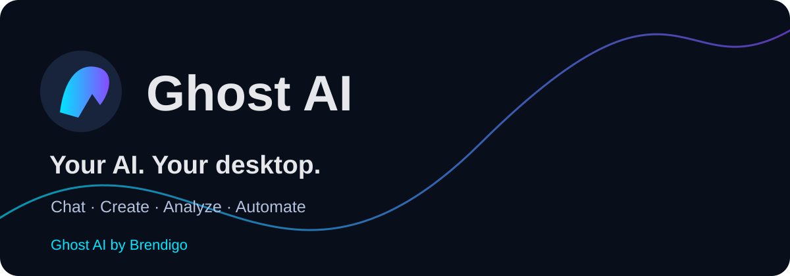
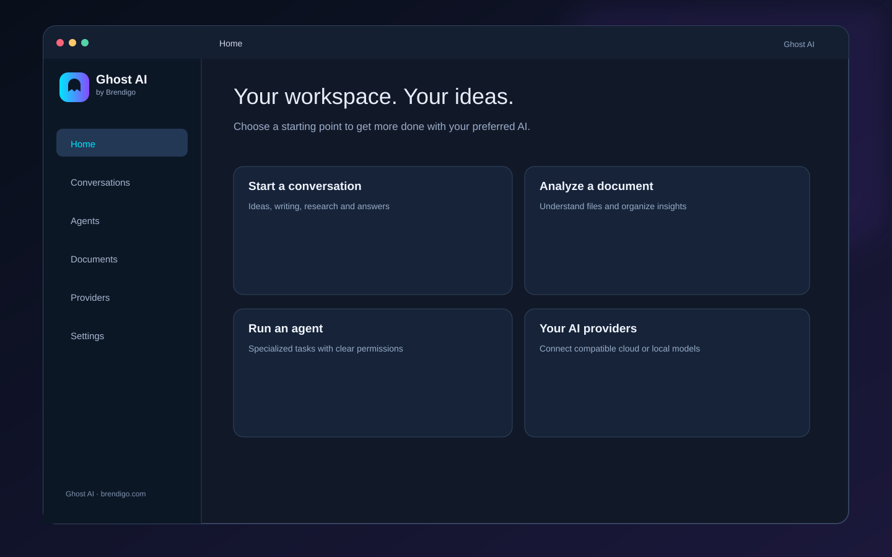
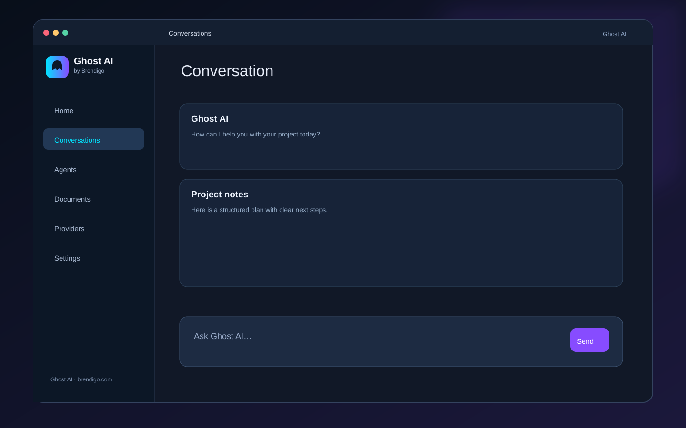
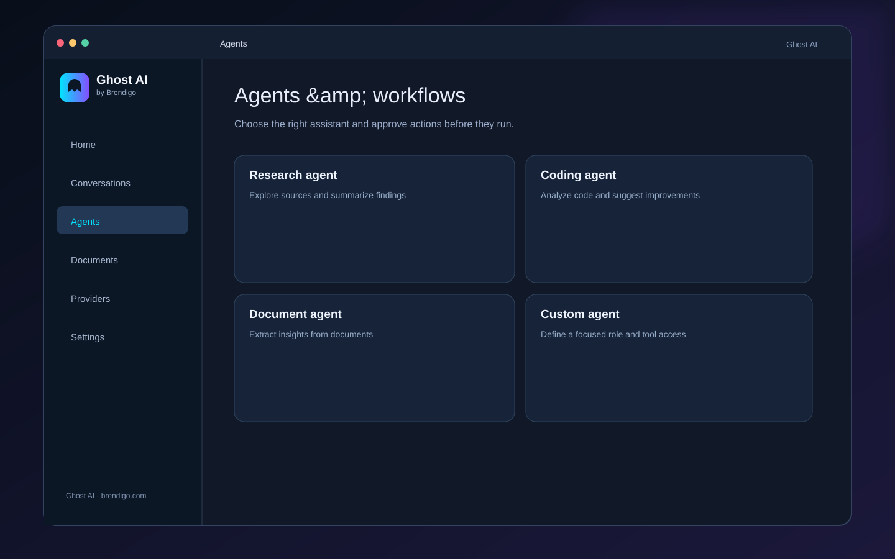
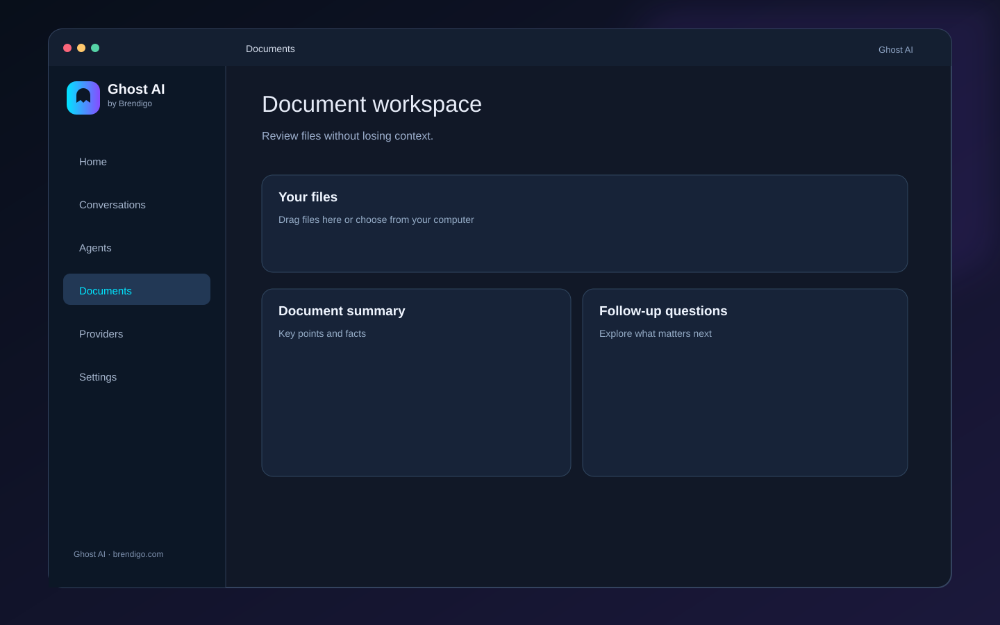
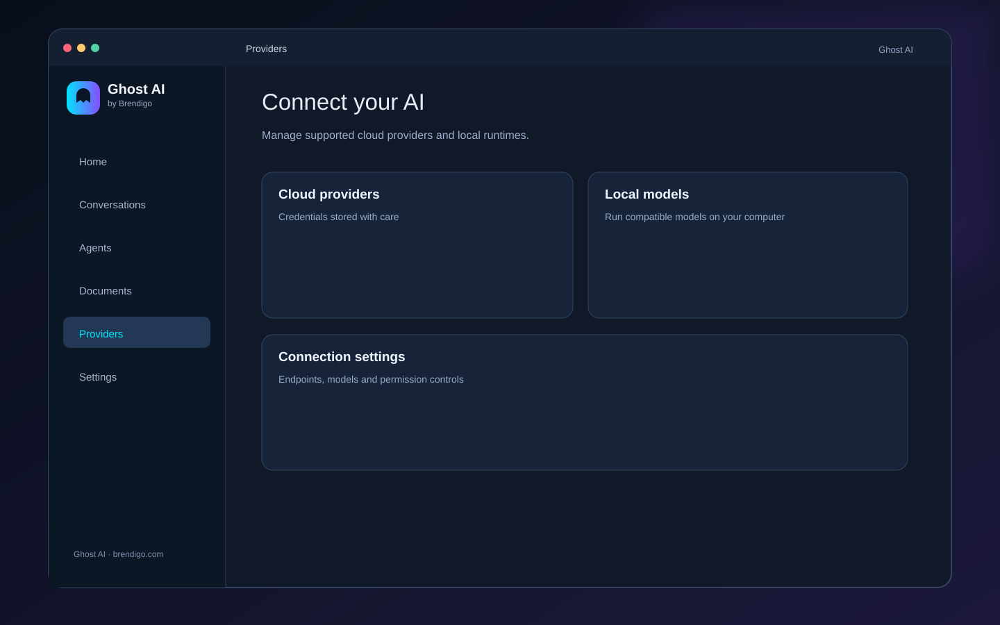
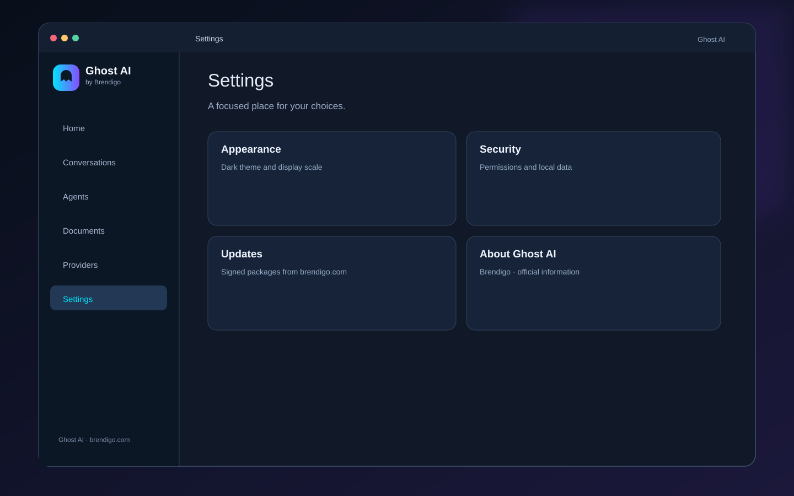

<!-- Ghost AI by Brendigo -->

  

<h1 align="center">Ghost AI</h1>

<strong>Your AI. Your desktop. Endless possibilities.</strong>

One beautifully focused place to chat, create, research, analyze and get things done.

  
  
  

## Meet a smarter way to work

Ghost AI brings your favorite compatible AI services and local models into a powerful, distraction-free workspace. Explore new ideas, understand files, write, research and work with specialized AI assistants — all from one app.

### Made for the way you think

| ✦ Powerful AI conversations | ◈ Intelligent document insights | ⌘ Coding, research and tools |
| :--- | :--- | :--- |
| Work with compatible AI services and local models. | Analyze documents you choose and uncover important details. | Discover tools, assistants and new ways to make progress. |

### One workspace. More freedom.

- **Your AI choice:** connect supported cloud AI providers or local runtimes.
- **Your conversations:** keep projects and important discussions organized.
- **Your files:** review documents and research with helpful AI tools.
- **Your control:** understand permissions before sensitive actions.
- **Your look:** elegant dark surfaces, cyan highlights and violet accents.
- **Your workflow:** tools, assistants and extensible integrations.

## A workspace made for ideas

  
  

  
  

  
  

<small>Design previews show the Ghost AI visual direction, not screenshots of a running app.</small>

## Designed to feel right, everywhere

Ghost AI uses a responsive interface designed for laptop screens, external monitors and different display scales. Its window opens at a comfortable size without filling the whole screen.

Every display should feel consistent. Real application screenshots are included only after capture and verification on a supported operating system.

## Available platforms

**Windows:** setup, portable package and installer-based update package.  
**macOS and Linux:** platform packages are provided after successful build, compatibility and distribution checks.

Download the latest verified packages from **[brendigo.com](https://brendigo.com)** when released. Public preview builds, when available, are also attached to releases in this repository.

## Safe by design

Ghost AI keeps local data on your computer and lets you choose the services you connect. Requests sent to external AI providers are governed by those providers' privacy practices and pricing. File and command tools require appropriate care and permissions.

## Publisher and legal information

**Ghost AI is published by Brendigo.**  
Official website: **https://brendigo.com**

- [End-user terms (EULA)](legal/EULA-HR.md)
- [Commercial distribution terms](legal/COMMERCIAL-LICENSE-HR.md)
- [Privacy information](legal/PRIVACY-HR.md)
- [Required third-party license notices](legal/THIRD_PARTY_NOTICES.md)

Ghost AI includes properly licensed open-source software. These notices are preserved as legally required and do not imply endorsement of the Ghost AI brand.

---

<strong>Ghost AI by Brendigo.</strong> Your ideas are just the beginning.

